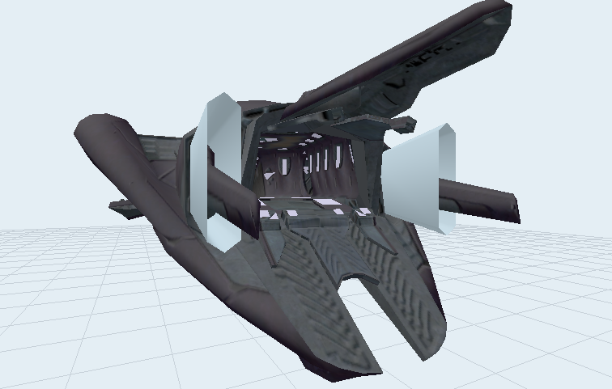
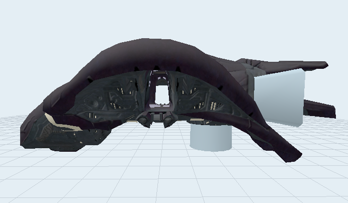
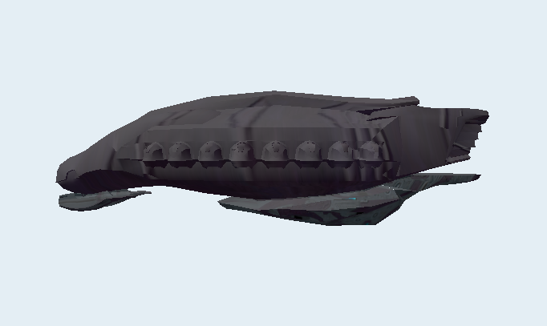

# Halo 2 Tags
 
A collection of my own created Halo 2 tags.

If you like my work, consider donating at https://ko-fi.com/lalsy
 
---
 
## Characters
 
No Characters yet 

 
---
 
## Vehicles
 
### Phantom Advanced (Under development)
 
 
 
In my vision, the Phantom was supposed to be what it was in Halo 2 E3, Halo 2 and Halo 3 but due to constraints it was never fully realized. My version has:

* Useable rear door
* Open grav lift
* Full interior
* Manned turrets that open via sides
* Landing gear
* TODO: Full open-able hatches on the side, like Halo 3.


 
### Halo 2 Cut Vehicle: Covenant Lightbridge Ship (Under development)
 
The covenant lightbridge ship that enables traversal across large chasms due to its deployable lightbridge ship. Requires some scripting

```
TODO: HSC here
```
 

 
### Halo 2 Cut Vehicle: Command Shuttle (Under development)
  
The covenant command shuttle seen in storyboards and blockouts, fully re-imagined as a full vehicle with deployable (scripted) drop pods.

```
TODO: HSC here
```

 

 
### Gameplay Enabled HEV ODST Pod
 
The ODST drop pod (HEV), now fully set up for use in gameplay. Below an example script on how to have it be placed.

Please follow the tutorial on C20.

```
(script dormant script_pod1
	(object_create pod1)

	(device_set_position pod1 1.0)
	(sleep (random_range 25 30))

	(ai_place drop_pods/1)

	(objects_attach pod1 "pod_attach" (ai_vehicle_get drop_pods/1) "pod_attach")
	(effect_new_on_object_marker effects\cinematics\05\hev_retro_rocket_short (ai_vehicle_get drop_pods/1) "retro_rocket")

	(sleep_until (>= (device_get_position pod1) 1) 1)
	(effect_new_on_object_marker pod_effect (ai_vehicle_get drop_pods/1) "hev_base")

	(sleep (random_range 20 40))

	(effect_new_on_object_marker effects\cinematics\05\hev_door_release (ai_vehicle_get drop_pods/1) "door_release")
	(sleep 30)
	(object_damage_damage_section (ai_vehicle_get drop_pods/1) "door" 500)

	(sleep (random_range 20 40))
	(ai_vehicle_exit drop_pods/1)

	(objects_detach pod1 (ai_vehicle_get drop_pods/1))
	(object_destroy pod1)
)
```
 
 
 

---
 
## Usage
 
1. Download the tags you want.
2. Copy them into your Halo 2 tags folder.
